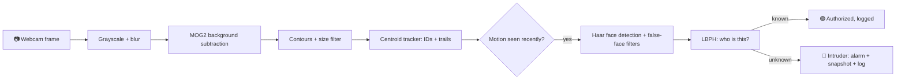

<div align="center">

# 🛡️ Home Protection System

### Motion Tracking + Face Recognition with Classical OpenCV

**CSC 126 Computer Vision · Midterm Project · Topic e: Motion and Object Tracking**


*A webcam alarm that knows who lives in the house. Friends get a friendly green box, strangers get a loud red one.* 🚨

</div>

---

## 📑 Table of Contents

- [🛡️ Home Protection System](#️-home-protection-system)
    - [Motion Tracking + Face Recognition with Classical OpenCV](#motion-tracking--face-recognition-with-classical-opencv)
  - [📑 Table of Contents](#-table-of-contents)
  - [✨ Features](#-features)
  - [⚡ Quick Start](#-quick-start)
  - [🔍 How It Works](#-how-it-works)
  - [🧠 Decision Logic](#-decision-logic)
  - [📚 Lab Topics Covered](#-lab-topics-covered)
  - [📁 Project Structure](#-project-structure)
  - [🔧 Installation](#-installation)
  - [🚀 Usage](#-usage)
    - [1️⃣ Register a resident](#1️⃣-register-a-resident)
    - [2️⃣ Train the recognizer](#2️⃣-train-the-recognizer)
    - [3️⃣ Arm the alarm](#3️⃣-arm-the-alarm)
  - [🎯 Calibrating Recognition](#-calibrating-recognition)
  - [🧰 Configuration](#-configuration)
  - [📸 Results](#-results)
  - [🩹 Troubleshooting](#-troubleshooting)
  - [🚧 Limitations](#-limitations)
  - [🔮 Future Improvements](#-future-improvements)
  - [👥 Team](#-team)

---

## ✨ Features

- 🎥 **Live webcam or a recorded video** as the input
- 🧭 **Object tracking:** every moving thing gets an ID and a motion trail
- 👤 **Resident recognition:** register as many people as you like, each with a guided photo session
- 🚨 **Intruder alarm:** unknown faces trigger a flashing banner, a beep and a snapshot
- 📸 **Evidence:** every alert saves a photo and writes a line to the log
- 🔍 **Debug view:** see exactly what the face detector is thinking
- ⌨️ **Live controls:** toggle the motion mask, trails and debug overlay
- 🧠 **100% classical computer vision:** no neural networks, no GPU

---

## ⚡ Quick Start

Already set up? These are the only three commands you need:

```bash
python register_face.py     # 1. add a resident (follow the on-screen steps)
python train.py             # 2. teach the system their face
python main.py              # 3. arm the alarm
```

First time here? Do the [Installation](#-installation) first.

---

## 🔍 How It Works



**🧭 Motion tracking (the star of topic e)**

1. MOG2 learns what the empty room looks like, so anything that moves stands out.
2. The mask is cleaned up (threshold, open, dilate) and turned into bounding boxes.
3. A **centroid tracker** matches each box to the closest one from the previous frame, so a person keeps the same ID while they walk around.
4. Trails show where each object has been, and the log records when it enters and leaves.

**👤 Face recognition**

1. A Haar cascade finds faces. Confidence, contrast and eye checks throw out false faces such as curtain folds and blankets.
2. Each face is cropped, resized and lighting-normalized with CLAHE.
3. An LBPH recognizer returns a name and a **distance**. Lower distance means a better match.
4. Registration uses a 68-point landmark model, so photos are only saved when your eyes, nose and mouth are visible and you really did the pose it asked for.

---

## 🧠 Decision Logic

| Situation | Result |
|---|---|
| 🟢 Registered face, distance below `THRESHOLD` | Green box with the name, tracked object turns green, `AUTHORIZED` logged |
| 🔴 Unknown face for 5+ frames in a row | Red `INTRUDER` box, flashing banner, beep, snapshot, log entry |
| 🟡 Something moving with no face | Yellow tracked box with an ID. Tracked, but no alarm |
| ⏱️ Another intruder within 10 s of an alarm | Cooldown: no repeat beep or snapshot |
| 🧑‍🤝‍🧑 Resident and stranger together | The stranger's unknown face still sets off the alarm |

---

## 📚 Lab Topics Covered

| Topic | Technique | Where |
|---|---|---|
| a. Image Operations | Resize, grayscale, Gaussian blur, morphology, histogram equalization and CLAHE | `main.py`, `facelib.py` |
| b. Image Segmentation | MOG2 background subtraction + thresholding | `main.py` |
| c. Haar Cascade Classifier | Frontal face and eye detection | `facelib.py` |
| d. Image Analysis | Contours, area filtering, bounding boxes | `main.py` |
| **e. Motion & Object Tracking** | **Centroid tracker with IDs and trails** | `CentroidTracker` in `main.py` |
| ➕ Extra | LBPH face recognizer, 68-point facial landmarks | `train.py`, `register_face.py` |

---

## 📁 Project Structure

```
CSC126Midterms/
├── main.py             # the alarm: motion tracking + recognition + alarm
├── register_face.py    # Step 1: guided face registration
├── train.py            # Step 2: train the LBPH model
├── facelib.py          # shared detection, filtering and preprocessing
├── requirements.txt
├── models/
│   ├── haarcascade_frontalface_default.xml
│   ├── haarcascade_eye.xml
│   └── lbfmodel.yaml   # (download, not committed)
├── screenshots/        # images used in this README
├── faces/              # (generated) registration photos, not committed
├── snapshots/          # (generated) intruder photos, not committed
├── events.log          # (generated) event history, not committed
├── model.yml           # (generated) trained model, not committed
└── names.json          # (generated) label-to-name map, not committed
```

> 🔒 Face photos and trained models stay off GitHub on purpose. Everyone generates their own.

---

## 🔧 Installation

```bash
git clone https://github.com/zedricdagdag-stack/CSC126Midterms.git
cd CSC126Midterms

python -m venv .venv
.venv\Scripts\activate              # macOS/Linux: source .venv/bin/activate

pip uninstall opencv-python         # only if it was installed before
pip install -r requirements.txt     # installs opencv-contrib-python
```

> [!IMPORTANT]
> Use **`opencv-contrib-python`**, not `opencv-python`. The face recognizer (`cv2.face`) only exists in the contrib build.

**Download the landmark model** (about 50 MB, used by registration). From the project root in PowerShell:

```powershell
Invoke-WebRequest -Uri "https://raw.githubusercontent.com/kurnianggoro/GSOC2017/master/data/lbfmodel.yaml" -OutFile models\lbfmodel.yaml
```

The two Haar cascades already ship in `models/`.

| Missing file | What happens |
|---|---|
| `lbfmodel.yaml` | Registration still works, but skips the eye, nose and mouth checks |
| `haarcascade_eye.xml` | `main.py` skips the eye check, so curtain false faces may come back |

---

## 🚀 Usage

Run everything from the project root.

### 1️⃣ Register a resident

```bash
python register_face.py
```

Type a name, then follow the on-screen steps. Press **SPACE** to start each one.

| Step | What to do |
|---|--- |
| 1 | Look straight at the camera |
| 2 | Turn a little toward the **left of the screen** |
| 3 | Turn a little toward the **right of the screen** |
| 4 | Tilt your head up just a little |
| 5 | Tilt your head down just a little |
| 6 | Smile big or open your mouth a little |

The screen tells you what is wrong ("Move closer", "Hold still", "Too dark", "Eyes open please"). Your eyes, nose and mouth are outlined live so you can see what the system sees.

> 💡 Keep turns small (about 15 degrees). If you can still see both of your eyes in the preview, you are fine. If the face box disappears, turn back a bit.
>
> Registering again with an existing name lets you **append** or **replace** photos. Doing a second round in different lighting really helps accuracy.

### 2️⃣ Train the recognizer

```bash
python train.py
```

Run it again every time you register someone new.

### 3️⃣ Arm the alarm

```bash
python main.py
```

To use a video instead of the webcam, change `SOURCE` at the top of `main.py` to a path like `"samples/test.mp4"`.

| Key | Action |
|---|---|
| `q` | Quit |
| `m` | Show or hide the motion mask |
| `t` | Show or hide motion trails |
| `d` | Debug overlay (see below) |

**🔍 Reading the debug overlay (`d`)**

Every face candidate gets a box and three numbers: `c` (detector confidence), `s` (contrast) and `e` (eyes found).

- 🟦 **Cyan** = accepted as a real face
- ⬜ **Gray** = rejected (low confidence, flat texture such as a curtain, or no eyes)

**🧭 Reading the main screen**

| You see | It means |
|---|---|
| 🟡 Yellow box, `ID 3` | A moving object being tracked |
| 🟢 Green box, `ID 3 ZED` | Tracked object belonging to a recognized resident |
| 🔴 Red box, `INTRUDER (85)` | Face not recognized. The number is the match distance |
| Bottom bar | `ARMED - monitoring` or `SCANNING FACES`, plus how many objects are tracked |

---

## 🎯 Calibrating Recognition

Every face label shows `name (distance)`. For LBPH, **lower is better**.

1. Run `main.py` and look at the camera. Note your distance. In our tests it was about **34 to 46**.
2. Have someone who is **not** registered look at the camera. Note their distance. It should be clearly higher.
3. Set `THRESHOLD` in `main.py` somewhere between the two numbers (the default is 70).

| Threshold | Effect |
|---|---|
| ⬇️ Lower | Stricter: fewer missed intruders, but residents may get flagged |
| ⬆️ Higher | More lenient: fewer false alarms on residents, but strangers may slip through |

> 💡 Register under the **same lighting** you will run in. Lighting is the biggest factor in accuracy.

---

## 🧰 Configuration

All settings are constants at the top of the files.

**`main.py`**

| Setting | Default | Meaning |
|---|---|---|
| `SOURCE` | `0` | `0` = webcam, or a video file path |
| `THRESHOLD` | `70` | Max LBPH distance counted as a resident |
| `MIN_MOTION_AREA` | `1500` | Ignore motion blobs smaller than this (pixels) |
| `ACTIVE_HOLD` | `5` s | How long faces keep being scanned after motion stops |
| `INTRUDER_FRAMES` | `5` | Frames a stranger must be seen before the alarm fires |
| `ALARM_COOLDOWN` | `10` s | Minimum time between alarms |
| `BANNER_TIME` | `3` s | How long the red banner stays up |
| `MAX_MISSED` | `15` | Frames a track survives without a matching blob |
| `MAX_MATCH_DIST` | `120` px | How far an object can move between frames and keep its ID |
| `TRAIL_LEN` | `40` | Points kept in each motion trail |
| `REQUIRE_MOTION_FOR_FACE` | `False` | If `True`, only faces on moving objects count |

**`facelib.py`**

| Setting | Default | Meaning |
|---|---|---|
| `MIN_CONF` | `2.0` | Minimum Haar detector confidence |
| `MIN_STD` | `30` | Minimum contrast inside a face box (rejects flat curtains and walls) |

**`register_face.py`** has quality and pose settings at the top (`MIN_SHARPNESS`, `YAW_TURN`, `PITCH_TURN`, `MIN_EAR` and more). The numbers on its bottom line show your live values so you can tune them.

---

## 📸 Results

| 🟢 Resident recognized | 🔴 Intruder alarm | 🌫️ Motion mask |
|:---:|:---:|:---:|
| _add screenshot_ | _add screenshot_ | _add screenshot_ |
| Green box with name | Red box and banner | Segmentation output |

To add images: put them in `screenshots/` and replace the placeholders with ``.

**📄 Sample `events.log`**

```
[2026-10-13 03:35:34] INTRUDER ALERT - snapshot saved: intruder_20261013_033534.jpg
[2026-10-13 03:35:39] TRACK: object #100 entered the scene
[2026-10-13 03:35:40] TRACK: object #100 left the scene
[2026-10-13 04:05:13] AUTHORIZED: ZED (distance 44)
```

**📏 Measured distances**

| Person | LBPH distance |
|---|---|
| Registered resident | about 34 to 46 |
| Stranger | _add after testing a second person_ |

---

## 🩹 Troubleshooting

| Problem | Fix |
|---|---|
| `detectMultiScale` assertion error or "Cascade failed to load" | The cascade file is missing. Make sure `models/haarcascade_frontalface_default.xml` exists. OpenCV 5.0 builds ship without cascade data, which is why this project loads files from `models/` |
| `module 'cv2' has no attribute 'face'` | `pip uninstall opencv-python`, then `pip install opencv-contrib-python` |
| `model.yml not found` | Run `register_face.py`, then `train.py` |
| "No face found" while registering | Turn less, face the light, move closer. The detector only finds faces within roughly 15 to 20 degrees of straight on |
| "Only one person in frame" | Someone else, or a face-shaped pattern, is in view. Try a plain background |
| You get flagged as an intruder | Raise `THRESHOLD`, or register again in your usual lighting and retrain |
| A stranger gets a resident's name | Lower `THRESHOLD` |
| A curtain or wall gets a face box | Press `d` and read the numbers, then adjust `MIN_CONF` and `MIN_STD` in `facelib.py` |
| No beep on Mac or Linux | The beep uses `winsound`, which is Windows-only. Other systems print a bell character |
| Too many "object entered/left" log lines | Raise `MIN_MOTION_AREA` to ignore small flickers |

---

## 🚧 Limitations

- Haar cascades work best on frontal faces.
- LBPH is sensitive to lighting, angle and distance.
- A printed photo of a resident could fool it, since there is no liveness check.
- Background subtraction only sees movement, and lighting changes or a moving camera can trigger it.
- A person standing perfectly still eventually loses their motion track (they are still recognized while their face is visible).

---

## 🔮 Future Improvements

- Deep-learning face detector and recognizer
- Face alignment using the eye positions for better accuracy
- Liveness detection (blink or depth check)
- Email, SMS or Telegram alerts
- Restricted zones and scheduled arming
- A web dashboard for the alarm history

---

## 👥 Team

| Name | Role |
|---|---|
| Member 1 | Developer |
| Member 2 | Developer |
| Member 3 | Documentation |

**Course:** CSC 126 Computer Vision · **Instructor:** _add name_ · **School:** _add school_

<div align="center">

⭐ Built with OpenCV and Python ⭐

</div>